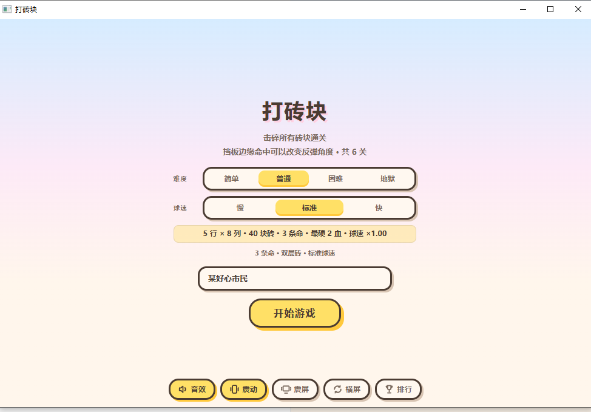
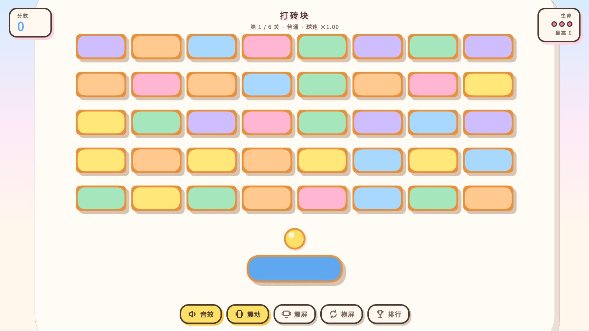
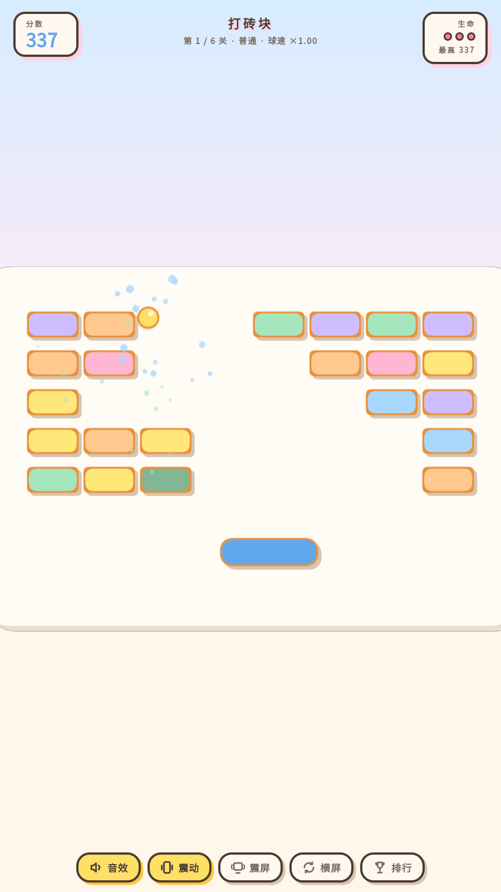

# 打砖块 · Brick Breaker

一个三端同源的打砖块小游戏：**网页 / Windows / 安卓**，一套 HTML + Three.js 代码跑在三个壳里。

界面走 Q 版可爱卡通：马卡龙浅色填充、暖橙粗描边、实心偏移投影、奶油白底。纯平面 2D，不做立体。

> 作者：某好心市民

---

## 截图

| Windows | 安卓（横屏） | 安卓（击碎砖块） |
|---|---|---|
|  |  |  |

---

## 特性

- **四档难度**：简单 / 普通 / 困难 / 地狱，砖块数量、生命数、最硬砖块血量、空洞率逐档递增
- **三档球速**：慢 0.72× / 标准 1.00× / 快 1.40×，菜单里实时换算成「X 行 × Y 列 · N 块砖 · M 条命 · 最硬 K 血 · 球速 ×Z」
- **横竖屏自适应**：竖屏把网格重排成 5 列多行，砖块始终横着砌；切方向不重建关卡、不丢进度、不能刷分
- **排行榜**：本地 Top10，记录难度、球速、关卡与用时，默认玩家名「某好心市民」
- **手感**：挡板边缘反弹改变角度、碰撞粒子、连击计分、屏幕震动、WebAudio 合成音效（无音频文件依赖）
- **纯矢量渲染**：砖块 / 球 / 挡板都是 `ShapeGeometry` 三层实体（投影层 + 描边层 + 填充层），不依赖任何贴图，任意分辨率下描边都锐利

---

## 目录结构

```
BrickBreaker3D/
├─ web/                     游戏本体（唯一视觉基准）
│  ├─ index.html
│  ├─ assets/css/style.css
│  ├─ assets/js/{game,app,sound,scores,fx}.js
│  └─ assets/vendor/three.min.js     Three.js r128 离线内置
├─ win/                     Windows 外壳（WebView2）
│  ├─ main.cpp
│  ├─ app.rc                图标 + 版本信息
│  └─ build.bat             一键编译
├─ android/                 安卓外壳（WebView 套壳）
├─ assets/icon/             应用图标（SVG 矢量源 + PNG 各尺寸 + app.ico）
├─ docs/DEVLOG.md           开发日志
└─ dist/                    打包产物
```

---

## 直接玩（不打包）

用浏览器打开 `web/index.html` 即可，不需要服务器，也不联网——Three.js 已经内置在 `assets/vendor/`。

---

## 打包

### Windows

需要 Visual Studio 2022 Build Tools（含 C++ 工作负载）和 WebView2 SDK。

```bat
cd win
build.bat
```

产物 `win/BrickBreaker3D.exe`，单文件绿色版。运行时会从 `../web` 或 exe 同级找 `web` 目录，所以整个仓库目录得一起分发。

窗口尺寸通道：页面通过 `postMessage('resize:宽x高')` 请求外壳改窗口大小，`main.cpp` 里用 `add_WebMessageReceived` 接收并 `ResizeClient` 居中——WebView 内部的 `window.resizeTo` 是无效的，必须走这条链路。

### 安卓

需要 JDK 17 与 Android SDK（compileSdk 35）。本项目实测环境：`jdk-17` + `android-35` + Gradle 8.9 + AGP 8.7.2。

```bash
# 先指到自己的 JDK / SDK
export JAVA_HOME=/path/to/jdk-17
export ANDROID_HOME=/path/to/android-sdk

gradle -p android assembleDebug
```

`preBuild` 会先跑 `syncWeb`，把 `web/` 整个同步进 `assets/web/`，所以不必手工复制页面代码。

产物 `android/app/build/outputs/apk/debug/app-debug.apk`。

外壳用 `screenOrientation="fullSensor"` + `configChanges="orientation|screenSize|..."`，旋转时 Activity 不重建，WebView 不重载，游戏进度和排行榜都不丢。系统栏沉浸式隐藏，屏幕上锁常亮。

### 网页发布

把 `web/` 整个目录丢到任意静态托管即可。

---

## 技术要点

**正交相机 + 平面圆盘**：相机是 `OrthographicCamera`，球是 XY 平面上的圆盘。绕 Z 轴自转形状不变，绕 X 轴一斜就会被正投影按余弦压成椭圆——所以球的滚动只允许绕 Z。

**跨方向不重建关卡**：切横竖屏时用 `captureLayout()` 把当前格子状态（血量/颜色/存活）按 `行:列` 快照下来，新方向按比例映射回去，行列数永远按当前方向重算，不会把竖屏网格带进横屏。

**不用 CSS 动画**：某些 WebView2 版本上 `@keyframes` 不出画面，`will-change` 同病。所有帧动画（震屏、闪屏、粒子）一律走 JS `requestAnimationFrame`。

**三段式卡片**：所有圆角块都是「投影层 → 描边层 → 填充层」叠出来的，跟 CSS 按钮的 `box-shadow` 实心投影是同一套视觉语言，所以画布里的砖块和 DOM 上的按钮看起来是同一个世界的东西。

---

## 许可

MIT License，见 [LICENSE](LICENSE)。
